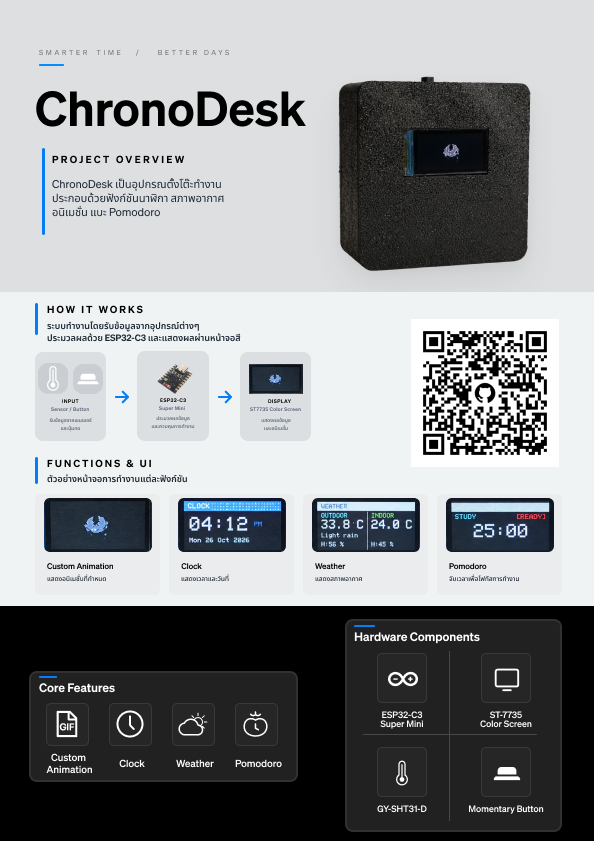
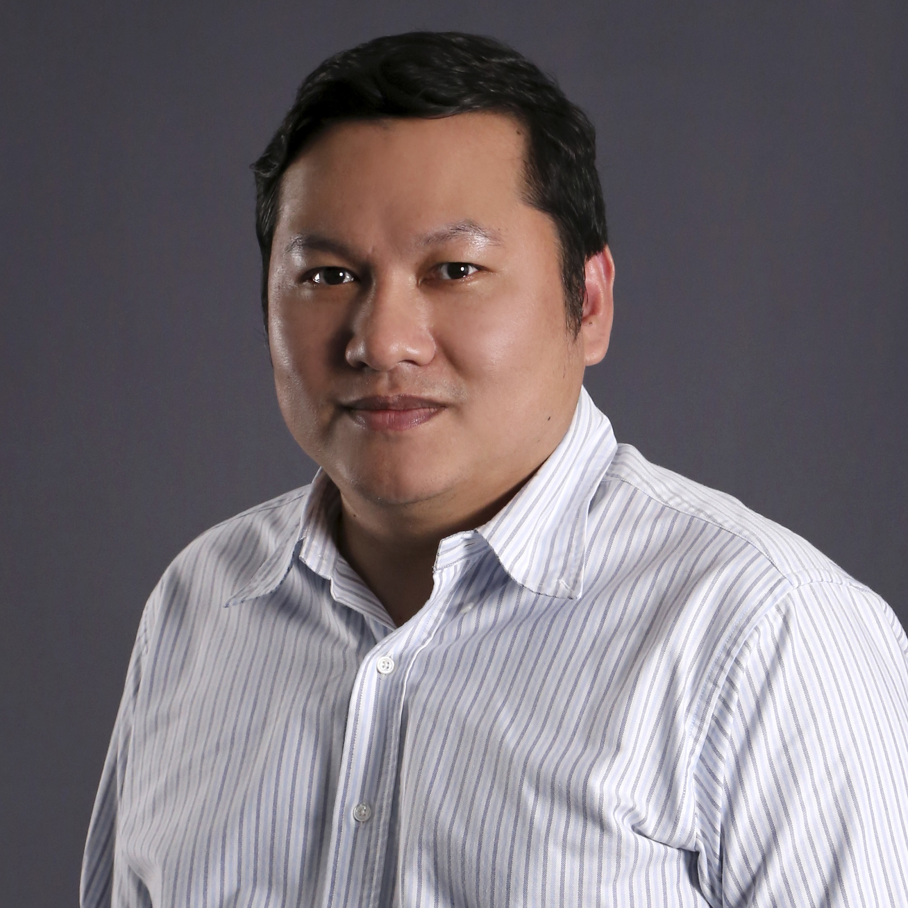

# ChronoDesk

ChronoDesk, Smart Desktop Clock System using ESP32-C3, sensors, and an interactive display.

### [Hardware folder](./Hardware/)
This folder contains the hardware design and documentation for the ChronoDesk device, including the enclosure design and circuit diagrams.

### [Software folder](./Software/)
This folder contains the firmware source code, display resources, and program logic for the ChronoDesk system.

https://github.com/WaratepBHN/ChronoDesk-PC-Project/blob/main/assets/VDO/ChronoDeskVDO.mp4

## Contributors

| ID       | Name                  | Role         | Img                                                                          |
| -------- | --------------------- | ------------ | ---------------------------------------------------------------------------- |
| 68070169 | นายวราเทพ ภานนท์      | Hardware Dev |  |
| 68070179 | นายศุภวิชญ์ สุขจันทร์ | Software Dev |  |

## Present 06016409 PHYSICAL COMPUTING

รองศาสตราจารย์ ดร. ปานวิทย์ ธุวะนุติ
